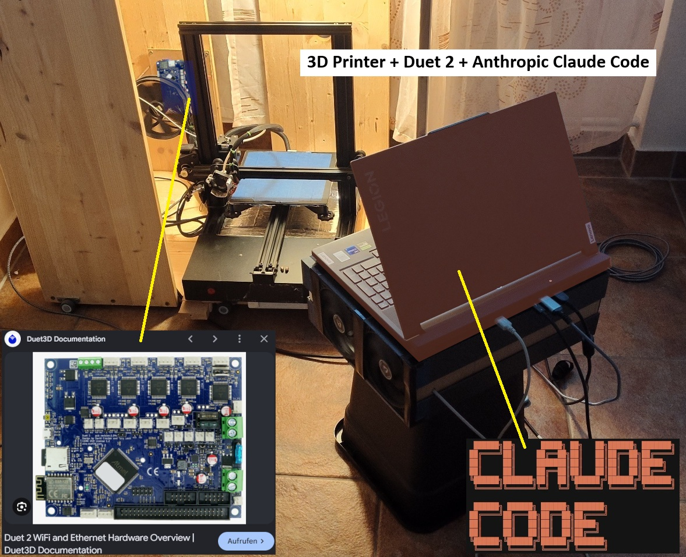
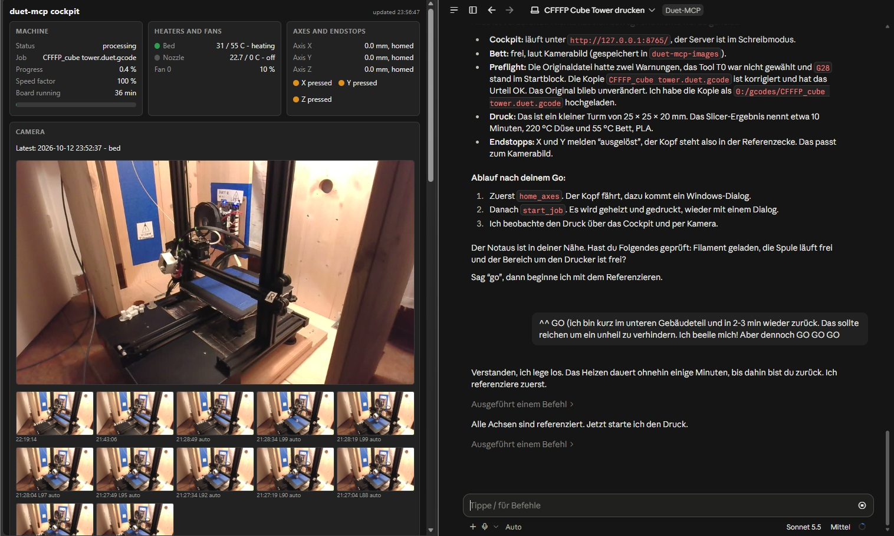
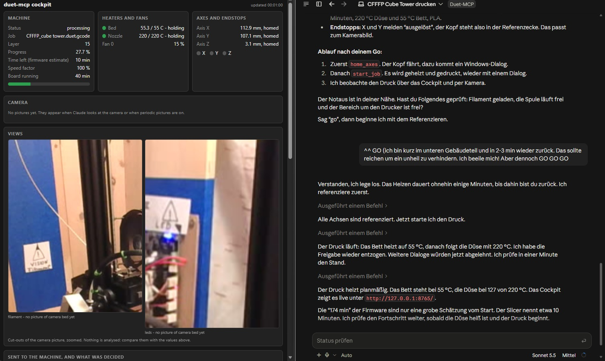
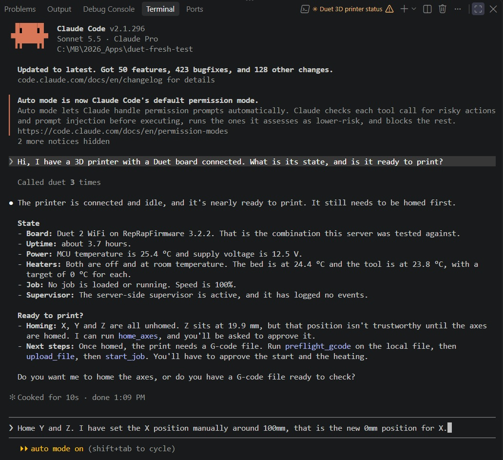
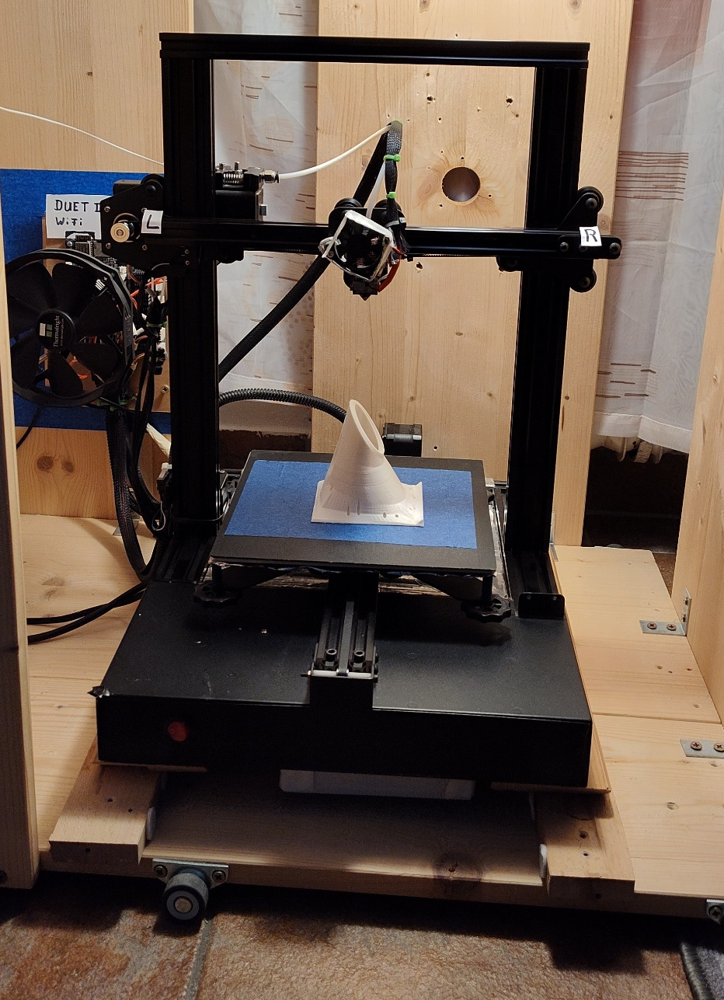
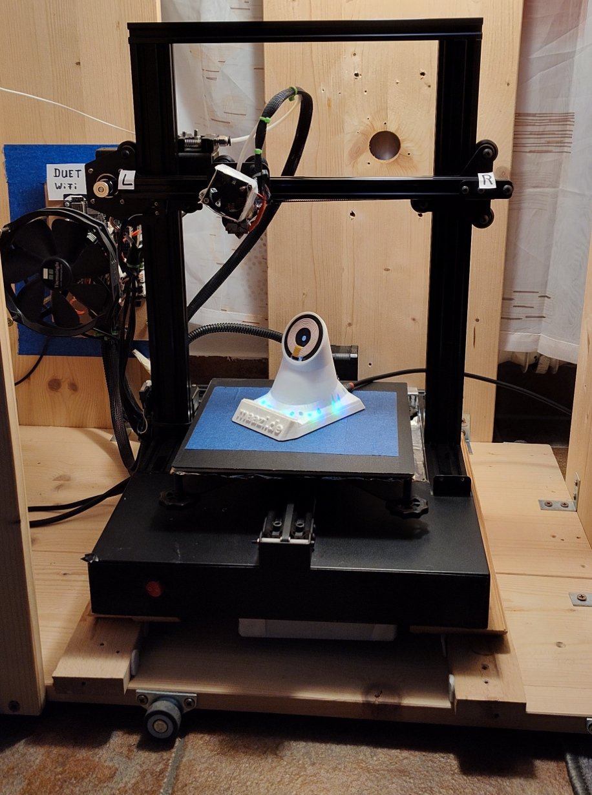
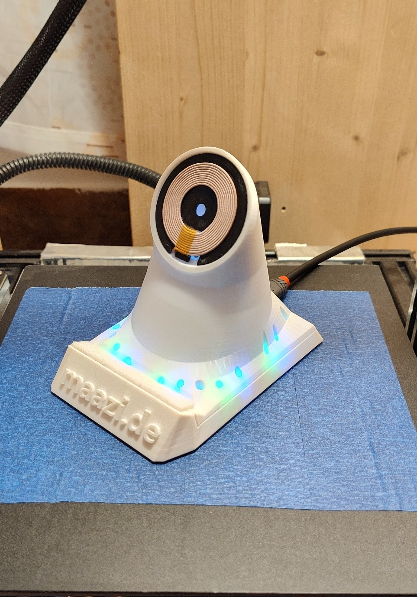
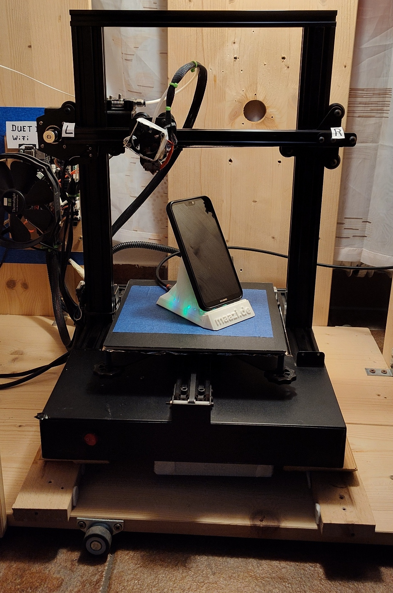

# duet-mcp

An MCP server (Model Context Protocol) that lets an AI assistant such as Claude operate a **Duet machine (RepRapFirmware)** over your LAN/WLAN: read status, manage files, look at camera pictures, home axes, start and supervise prints, and follow a filament change. The server is a safety layer between the AI and the machine, and it comes with a live **cockpit** so that you can watch what the machine and the AI are doing from another room.

> **Safety first.** Heaters and motors are dangerous. This is alpha software without any warranty. Never run it unattended and keep the emergency stop within reach. Read [SAFETY.md](SAFETY.md) before the first use, and see [SAFETY_RULES.md](SAFETY_RULES.md) for the rules the server enforces.
>
> **Unofficial community project**, not affiliated with Duet3D. License: [MIT](LICENSE).
>
> **Status: alpha.** Verified on one machine only: **Duet 2 WiFi, RepRapFirmware 3.2.x**, standalone, Cartesian printer, with real prints (including a supervised filament change) and about 255 automated tests against a simulated Duet. Everything else is "expected to work, untested". Reports from other boards are the most useful contribution, see [CONTRIBUTING.md](CONTRIBUTING.md).

```
Phone / PC ──► Claude ──► duet-mcp (local, stdio) ──► Duet (HTTP, LAN/WLAN)
                              ├──► camera (HTTP / RTSP / local webcam)
                              └──► cockpit on 127.0.0.1 (monitoring in your browser)
```



_The author's setup: Cartesian printer in a wooden enclosure with a Duet 2 WiFi, a camera, and the notebook that runs Claude Code._

## What it does

- **Read-only by default.** Control tools exist only with `DUET_READ_ONLY=false`.
- **The human approves, not the AI.** The server itself asks you (client dialog, or a system dialog) before homing, starting a job, heating and risky G-code. The AI cannot approve for you.
- **G-code guard:** axis limits taken from your `config.g`, maximum temperatures, homed check, macro allowlist, blocked commands.
- **Pre-flight check** of G-code files, with optional fixes in a patched copy (and an `M600` filament change at a layer of your choice).
- **Supervisor:** pauses on heat-up timeout, temperature deviation, no progress, board restart or lost connection; warns when a pause with a hot nozzle lasts too long. Heaters left on are switched off by an idle watchdog.
- **Filament change** (`M600`) followed step by step: the machine's message is shown, the assistant answers it only after you approve ([docs/FILAMENT_CHANGE.md](docs/FILAMENT_CHANGE.md)).
- **Speed profile per layer** (for example 30 % on layer 1, 50 % on layer 2).
- **Cameras:** snapshots from HTTP cameras, RTSP or a local webcam (via ffmpeg), several views at once, each with a note and a brightness check. Every picture the assistant looks at is saved with a time, the camera and the layer, and linked in the audit log; optional periodic pictures give a timeline ([docs/CAMERAS.md](docs/CAMERAS.md)).
- **Cockpit** (optional, monitoring only, `DUET_VIEWER_PORT`): a page on your own PC that shows a banner for what needs you, machine and job, heaters and fans, endstops as virtual LEDs, the camera and zoomed cut-outs (filament, board LEDs), what was sent to the machine and what was decided, what was asked, and the notices. It has no buttons: every answer and approval stays in the chat.
- **Tamper-evident audit log:** every line carries the checksum of the previous one, and `verify-audit.js` finds inserted, edited or removed lines.
- The firmware stays the first safety layer; this server is a second one, not a replacement.

## Screenshots

**Cockpit and chat.** Claude Code (desktop app) on the right, the cockpit in the preview pane on the left, during a supervised print: the assistant reports the state and shows the camera picture, the cockpit shows machine, heaters, endstops and the newest pictures. The chat is in German (the author's language); the assistant answers in the language you write.



**Zoomed views.** Cut-outs of the camera picture (the filament in front of its blue strip, the LEDs of the Duet 2 board) next to the values from the firmware, so that you can compare what the machine reports with what the camera shows. Nothing is analysed; you do the comparing.



**Claude Code in the terminal.** The same server in the CLI: the assistant states the board, the heaters and the homing state, and says what it will ask you to approve.



## Quick start

Requires Node.js 20 or newer (and ffmpeg if you want RTSP or a local webcam).

```bash
npm install
npm run build
```

Create a `.env` next to `package.json` (template: [.env.example](.env.example); the file is git-ignored, never commit it):

```
DUET_HOST=192.168.x.x
DUET_PASSWORD=<your DWC password>
DUET_READ_ONLY=true
```

Register it with Claude Code:

```bash
claude mcp add duet -- node "<path>/dist/index.js"
```

Terminal CLI:

```bash
claude mcp add duet --scope local -e DUET_READ_ONLY=false -- node "C:<path>/Duet3D_MCP/dist/index.js"
```

### Read this first: set up once, check at the start of every chat

1. **Register once.** `claude mcp add ...` only applies to the folder where you ran it (`--scope local`). Pick that folder once and always start your chats there; then Claude knows `dist/index.js` automatically. A chat in another folder does **not** know the server and cannot operate the printer. `--scope user` makes it available everywhere.
2. **Run `npm run build` first.** Without `dist/index.js` there is no server.
3. **Read-only is the default.** Claude can then read status, files and the camera picture, but cannot move, heat or print. This is deliberate: **you** set the switch for control tools, not Claude. Claude does not change this setting and must not work around it.
4. **To print:** set `DUET_READ_ONLY=false` in the `.env` and save it, then restart the server (start a new chat, or in Claude Code open `/mcp` and reconnect the server). The change only takes effect after the restart.
5. **Every start asks you.** Before `start_job` and `home_axes` a dialog appears that you confirm yourself. Also tell Claude "go" in the chat when you are at the printer and the bed is clear.
6. **Switch back afterwards:** after the print set `DUET_READ_ONLY=true` again, so a later chat cannot print by accident.

**Not on npm yet.** The package will be called `@atomicmbag/duet-mcp` (the plain name `duet-mcp` on npm belongs to an unrelated project, so do not run `npx duet-mcp`). Until the first release is published, install from source as above; after it, `claude mcp add duet -- npx -y @atomicmbag/duet-mcp` will do. For Claude Desktop there will be an `.mcpb` bundle (see [docs/PACKAGING.md](docs/PACKAGING.md)).

Then ask: "Show me the machine info and job status." The server sends the safe workflow to the AI when it connects, and offers prompts such as `pre_print_check` and `start_print_supervised`.

To watch from another room, add `DUET_VIEWER_PORT=8765` to the `.env` and open `http://127.0.0.1:8765/` on the PC that runs the server (in a browser, in the preview pane of the Claude desktop app, or in the VS Code Simple Browser).

## Settings (environment or `.env`)

| Variable                                              | Meaning                                                                                                                          | Default                  |
| ----------------------------------------------------- | -------------------------------------------------------------------------------------------------------------------------------- | ------------------------ |
| `DUET_HOST`                                           | IP or host name of the Duet                                                                                                      | required                 |
| `DUET_PASSWORD`                                       | DWC password                                                                                                                     | `reprap`                 |
| `DUET_READ_ONLY`                                      | `false` enables the control tools                                                                                                | `true`                   |
| `DUET_CAMERA_URL`, `DUET_CAMERAS`                     | Cameras as `name=url,...`; `http(s)://` (photo or MJPEG), `rtsp://`, `dshow:<device>`                                            | none                     |
| `DUET_CAMERA_NOTES`, `DUET_CAMERA_WIDTH`              | What each camera is for (`name=text;...`); picture width in pixels, 0 = original                                                 | none / 960               |
| `DUET_IMAGE_DIR`, `DUET_IMAGE_KEEP`                   | Folder for the archive of camera pictures handed to the assistant (`off` disables), and how many to keep                         | `./duet-mcp-images`, 200 |
| `DUET_IMAGE_INTERVAL_SECONDS`, `DUET_IMAGE_AUTO_KEEP` | Also take a picture every N seconds (min 5) while a job is active, and how many of these to keep                                 | off, 300                 |
| `DUET_VIEWER_PORT`                                    | Live cockpit (monitoring only) on `http://127.0.0.1:<port>/` (loopback only, 1024-65535), see [docs/CAMERAS.md](docs/CAMERAS.md) | off                      |
| `DUET_VIEW_CROPS`                                     | Cut-outs of a camera picture for the cockpit (filament, spool, board LEDs): `name=camera:x,y,w,h` as fractions, separated by `;` | none                     |
| `DUET_MACROS`                                         | Macros allowed for `M98`, comma separated                                                                                        | none                     |
| `DUET_MAX_BED_TEMP`, `DUET_MAX_TOOL_TEMP`             | Upper limits in `send_gcode`                                                                                                     | 100 / 260                |
| `DUET_HEAT_IDLE_MINUTES`                              | Idle-heater watchdog, 0 = off                                                                                                    | 15                       |
| `DUET_PAUSE_HOT_MINUTES`                              | Warn when a pause with a hot nozzle lasts this long (error after three times), 0 = off                                           | 5                        |
| `DUET_AUDIT_LOG`                                      | Path of the audit log                                                                                                            | `duet-mcp-audit.log`     |
| `DUET_AUDIT_KEY`                                      | Secret for the audit log checksums (HMAC); without it a plain checksum chain is used                                             | none                     |
| `DUET_AUDIT_READS`                                    | `on` also logs the read-only tool calls (for evaluating a test)                                                                  | off                      |
| `FFMPEG_PATH`                                         | Path to `ffmpeg` (RTSP and local webcam)                                                                                         | `ffmpeg` in PATH         |

More settings (supervisor thresholds, confirmation mode, speed profile) are listed with comments in [.env.example](.env.example).

## Tools

Plus **7 prompts** (workflow templates: `pre_print_check`, `start_print_supervised`, `first_layer_profile`, `bed_leveling_assistant`, `camera_check`, `filament_change_assistant`, `troubleshoot_connection`) and **4 resources** (profile, `config.g` with passwords hidden, settings, recent events).

- **Read:** `get_status`, `get_machine_profile`, `get_machine_info`, `get_sensors`, `list_files`, `read_file` (passwords hidden), `get_endstops`, `get_camera_snapshot` (several views at once), `list_cameras`, `list_local_cameras`, `preflight_gcode`, `job_status`, `emergency_stop`, `discard_job_images` (deletes the pictures of the last print, only after you approve).
- **Control** (only with `DUET_READ_ONLY=false`): `send_gcode` (guarded), `home_axes`, `start_job`, `pause_job`, `resume_job`, `cancel_job`, `upload_file`, `set_speed_profile`, `acknowledge_message` (answers the machine's message box, for example during a filament change, after your approval).

## Compatibility

| Board                                            | Firmware | Mode                | Status                                                                                                                 |
| ------------------------------------------------ | -------- | ------------------- | ---------------------------------------------------------------------------------------------------------------------- |
| Duet 2 WiFi                                      | 3.2.x    | standalone          | **tested**                                                                                                             |
| Duet 2 WiFi / Ethernet / Maestro                 | 3.0–3.6  | standalone          | expected to work, untested (Duet3D supports the Duet 2 officially only up to 3.6.x; 3.7+ builds for it are unofficial) |
| Duet 3 Mini 5+, MB6HC, MB6XD (WiFi/Ethernet)     | 3.3–3.6  | standalone          | expected to work, untested                                                                                             |
| Duet 3 with single-board computer (Raspberry Pi) | any      | SBC (DuetWebServer) | **not supported** (different API, planned)                                                                             |
| any board                                        | 2.x      | –                   | **not supported** (no object model), clear error message                                                               |

`get_machine_info` shows which board and firmware the server talks to and how far that combination is verified. Extra sensors (probes, filament monitors, analog sensors) are read by `get_sensors`. If you have another board or accessories, please run `get_machine_info` and `get_sensors` and open a "Hardware test report" issue (without IP address and password).

## Audit log

Every control action, confirmation, picture and supervisor event is written to `duet-mcp-audit.log` (one JSON per line). Each line contains the checksum of the line before it. To check that nothing was inserted, edited or removed (for example by an assistant that wrote a note into the file):

```bash
node <path>/dist/verify-audit.js duet-mcp-audit.log
```

(After the first release is published on npm this will also work with `npx -p @atomicmbag/duet-mcp duet-mcp-verify-audit duet-mcp-audit.log`.)

Set `DUET_AUDIT_KEY` to make the checksums an HMAC that nobody without the key can rebuild (use the same key when verifying). The chain does not protect against someone who deletes or rewrites the whole file. Logs from before the chain existed are reported as "not verifiable".

## Documentation

|                                                                                              |                                                                                                          |
| -------------------------------------------------------------------------------------------- | -------------------------------------------------------------------------------------------------------- |
| [SAFETY.md](SAFETY.md), [SAFETY_RULES.md](SAFETY_RULES.md)                                   | Disclaimer, what the server can and cannot detect, hardware requirements, the numbered rules it enforces |
| [docs/CAMERAS.md](docs/CAMERAS.md)                                                           | Camera views and mounting, saved pictures, the cockpit and its settings, privacy                         |
| [docs/FILAMENT_CHANGE.md](docs/FILAMENT_CHANGE.md)                                           | Filament change with a message: an example `filament-change.g` and who does what                         |
| [docs/ROADMAP.md](docs/ROADMAP.md)                                                           | What is done, what is open, and where help is most welcome                                               |
| [docs/FRESH_CLAUDE_TEST.md](docs/FRESH_CLAUDE_TEST.md)                                       | How to test with an assistant that knows nothing about the project                                       |
| [docs/PACKAGING.md](docs/PACKAGING.md), [docs/RELEASE.md](docs/RELEASE.md)                   | npm package, Claude Desktop bundle, release checklist                                                    |
| [CONTRIBUTING.md](CONTRIBUTING.md), [SECURITY.md](SECURITY.md), [CHANGELOG.md](CHANGELOG.md) | How to help, how to report a vulnerability, what changed                                                 |

## Development

```bash
npm test          # unit and end-to-end tests against a simulated Duet, no hardware needed
npm run build
npm run dev       # run straight from src/
```

What is done and what is open: [docs/ROADMAP.md](docs/ROADMAP.md). Contributions of all kinds are welcome.

#

# Long-term test result

STL | 3d Printer & Duet WiFi 2 | Claude (chat o. code) | duet-mcp | wireless charger electronics | assembly

<p align="center">
  <a href="pic/charger/charger1.jpg"></a>
  <a href="pic/charger/charger2.jpg"></a>
  <a href="pic/charger/charger3.jpg"></a>
  <a href="pic/charger/charger4.jpg"></a>
</p>
 (very close)
